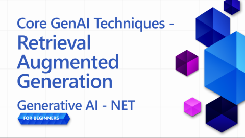

# Local Model Runners

**Already using Ollama?** You do not need to install another model runner to finish the course. Follow the [Ollama-only learning path](../docs/ollama-learning-path.md). The runners below are optional alternatives.

**Prefer Foundry Local?** Follow its [five-lesson alternative route](../docs/foundry-local-learning-path.md), starting with [SDK setup](../01-IntroductionToGenerativeAI/setup-foundry-local.md). It needs neither Ollama nor Azure credentials.

In this lesson, you'll learn how to run AI models locally using three popular approaches, and how to integrate them with your .NET applications.

---



The previous video shortcut redirects to search, not a recording. Use the written walkthrough below and the [local learning path](../docs/ollama-learning-path.md).

---

## Why Run Models Locally?

Running models locally provides several benefits:

- **Data locality** – Inference can remain on-device; remote tools, downloads and telemetry require separate review
- **Cost efficiency** – No usage charges for API calls
- **Offline availability** – Prepared models can run locally; verify cached startup and dependencies before promising air-gapped use
- **Customization** – Fine-tune models for specific use cases

This lesson covers three popular approaches:

- **[AI Toolkit for Visual Studio Code](https://code.visualstudio.com/docs/intelligentapps/overview)** – A suite of tools for Visual Studio Code that enables running AI models locally
- **[Docker Model Runner](https://docs.docker.com/model-runner/)** – A containerized approach for running AI models with Docker
- **[Foundry Local](https://learn.microsoft.com/azure/foundry-local/get-started?wt.mc_id=dotnet-0000-brunocapuano)** – A runtime and SDK for running catalog models locally

---

## Part 1: AI Toolkit for Visual Studio Code

The AI Toolkit for Visual Studio Code is a collection of tools and technologies that help you build and run AI applications locally on your PC. It leverages platform capabilities to optimize AI workloads.

### Key Features

- **DirectML** – Hardware-accelerated machine learning primitives
- **Windows AI Runtime (WinRT)** – Runtime environment for AI models
- **ONNX Runtime** – Cross-platform inference accelerator
- **Local model downloads** – Access to optimized models for Windows

### Getting Started

1. [Install the AI Toolkit for Visual Studio Code](https://code.visualstudio.com/docs/intelligentapps/overview)
2. Download a supported model
3. Use the APIs through .NET or other supported languages

> 📝 **Note**: AI Toolkit for Visual Studio Code requires Visual Studio Code and compatible hardware for optimal performance.

---

## Part 2: Docker Model Runner

Docker Model Runner is a tool for running AI models in containers, making it easy to deploy and run inference workloads consistently across different environments.

### Key Features - Docker Model Runner

- **Containerized models** – Package models with their dependencies
- **Cross-platform** – Run on Windows, macOS, and Linux
- **Built-in API** – RESTful API for model interaction
- **Resource management** – Control CPU and memory usage

### Getting Started - Docker Model Runner

1. [Install Docker Desktop](https://www.docker.com/products/docker-desktop/)
2. Pull a model image
3. Run the model container
4. Interact with the model through the API

```bash
# Pull and run a Llama model
docker run -d -p 12434:8080 \
  --name deepseek-model \
  --runtime=nvidia \
  ghcr.io/huggingface/dockerfiles/model-runner:latest \
  deepseek-ai/deepseek-llm-7b-chat
```

---

## Part 3: Foundry Local

[Foundry Local](https://learn.microsoft.com/azure/foundry-local/get-started?wt.mc_id=dotnet-0000-brunocapuano) runs catalog models on your own hardware. Its SDK supports native in-process inference and an optional OpenAI-compatible server. Product runtime packaging spans Windows, Linux and Apple Silicon macOS; the new course route is qualified on Windows x64 CPU.

- **Official documentation:** [Foundry Local SDK](https://learn.microsoft.com/azure/foundry-local/reference/reference-sdk-current?wt.mc_id=dotnet-0000-brunocapuano)
- **GitHub repository:** [Foundry Local](https://github.com/microsoft/Foundry-Local?wt.mc_id=dotnet-0000-brunocapuano)

### Key Features - Foundry Local

- **Cross-platform** – Windows, Linux, and macOS
- **Microsoft models** – Run models from Microsoft Foundry locally
- **REST API** – Interact with models using a local API endpoint
- **No cloud dependency** – All inference runs on your machine

### Getting Started - Foundry Local

1. Follow [course setup](../01-IntroductionToGenerativeAI/setup-foundry-local.md) with the .NET 11 SDK and .NET 10 runtime.
2. Explicitly prepare the model using `--prepare`.
3. Use native `ChatSession` for the Hello World, or the SDK-managed loopback endpoint for MEAI.
4. Continue through [local RAG, agents and MCP](../docs/foundry-local-learning-path.md).

No separate CLI/server installation or fixed port is required by this route.

For an optional typed-decision example, see [Foundry Local decisions](../samples/CoreSamples/Decision-13-FoundryLocal/README.md). Unlike the route above, this sample requires the Foundry Local CLI to cache a compatible decision model. The [Llama App text and image samples](../samples/CoreSamples/DECISION-MODEL-SAMPLES-README.md) use a separate local server and model installation.

---

## Part 4: Using AI Toolkit for Visual Studio Code with .NET

The AI Toolkit for Visual Studio Code provides a way to run AI models locally on your machine.

### Microsoft Extensions for AI with AI Toolkit

The [AIToolkit-02-MEAI-Chat](../samples/CoreSamples/AIToolkit-02-MEAI-Chat/) project demonstrates how to use Microsoft Extensions for AI to interact with AI Toolkit for Visual Studio Code models.

```csharp
// Example code demonstrating AI Toolkit for Visual Studio Code with MEAI
OpenAIClientOptions options = new OpenAIClientOptions();
options.Endpoint = new Uri(endpoint);
ApiKeyCredential credential = new ApiKeyCredential(apiKey);
// Create a chat client using local model through AI Toolkit for Visual Studio Code
ChatClient client = new OpenAIClient(credential, options).GetChatClient(modelId);
```

---

## Part 5: Using Docker Models with .NET

### Microsoft Extensions for AI with Docker Models

The [DockerModels-02-MEAI-Chat](../samples/CoreSamples/DockerModels-02-MEAI-Chat/) project demonstrates how to use Microsoft Extensions for AI to interact with Docker-based models.

```csharp
var model = "ai/deepseek-r1-distill-llama";
var base_url = "http://localhost:12434/engines/llama.cpp/v1";
var api_key = "unused";

OpenAIClientOptions options = new OpenAIClientOptions();
options.Endpoint = new Uri(base_url);
ApiKeyCredential credential = new ApiKeyCredential(api_key);

ChatClient client = new OpenAIClient(credential, options).GetChatClient(model);

// Build and send a prompt
StringBuilder prompt = new StringBuilder();
prompt.AppendLine("You will analyze the sentiment of the following product reviews...");
// ... add more text to the prompt

var response = await client.CompleteChatAsync(prompt.ToString());
Console.WriteLine(response.Value.Content[0].Text);
```

---

## Part 6: Using Foundry Local with .NET

### Microsoft Extensions for AI with Foundry Local

Use [FoundryLocal-01Techniques](../samples/CoreSamples/FoundryLocal-01Techniques/README.md) for SDK-managed endpoint discovery and official OpenAI-to-MEAI adaptation. The complete [setup snippet](../01-IntroductionToGenerativeAI/setup-foundry-local.md#2-run-locally-through-meai) is compiled by the route's build checks.

The earlier [AIFoundryLocal-01-MEAI-Chat](../samples/CoreSamples/AIFoundryLocal-01-MEAI-Chat/Program.cs) uses a raw OpenAI client with a fixed GPU ID/port. It remains reference material, not the current provider initializer.

---

## Running the Samples

For the new Foundry Local route, use its [setup commands](../01-IntroductionToGenerativeAI/setup-foundry-local.md); the SDK owns lifecycle. For the other runner-specific reference samples:

1. Install Docker Desktop, AI Toolkit for Visual Studio Code, or Foundry Local as needed
2. Pull or download the required model
3. Start the local model server required by that particular reference sample
4. Navigate to one of the sample project directories
5. Run the project with `dotnet run`

---

## Comparing Local Model Runners

| Feature | AI Toolkit for Visual Studio Code | Docker Model Runner | Foundry Local |
|---------|-------------------------------|---------------------|--------------|
| Platform | Windows, macOS, Linux | Cross-platform | Cross-platform |
| Integration | Visual Studio Code APIs | REST API | Native SDK or optional local API |
| Deployment | VS Code Extension | Container-based | Embedded SDK; CLI optional |
| Hardware Acceleration | DirectML, DirectX | CPU, GPU | CPU, GPU |
| Models | Optimized for VS Code | Any containerized model | Microsoft Foundry models |

---

## Sample Code Reference

| Sample | Description |
|--------|-------------|
| [AIToolkit-02-MEAI-Chat](../samples/CoreSamples/AIToolkit-02-MEAI-Chat/) | AI Toolkit with Microsoft Extensions for AI |
| [DockerModels-02-MEAI-Chat](../samples/CoreSamples/DockerModels-02-MEAI-Chat/) | Docker Model Runner with MEAI |
| [FoundryLocal-01Techniques](../samples/CoreSamples/FoundryLocal-01Techniques/README.md) | Foundry Local with MEAI and SDK-owned lifecycle |

---

## Additional Resources

- [AI Toolkit for Visual Studio Code Documentation](https://code.visualstudio.com/docs/intelligentapps/overview)
- [Docker Model Runner Documentation](https://docs.docker.com/model-runner/)
- [Foundry Local Documentation](https://learn.microsoft.com/azure/foundry-local/get-started?wt.mc_id=dotnet-0000-brunocapuano)
- [Foundry Local GitHub Repository](https://github.com/microsoft/Foundry-Local?wt.mc_id=dotnet-0000-brunocapuano)
- [Microsoft Extensions for AI Documentation](https://learn.microsoft.com/dotnet/ai/)

---

## Lesson Complete

You now know how to run AI models locally using three approaches:

- **AI Toolkit for VS Code**: Integrated development experience with DirectML acceleration
- **Docker Model Runner**: Containerized, cross-platform model execution
- **Foundry Local**: Microsoft models running entirely on your hardware

Combined with the cloud-based patterns from earlier parts, you can now choose the right deployment approach for any scenario.

---

## What's Next?

You're ready to move beyond patterns into building **AI Agents**, systems that can plan, use tools, and collaborate autonomously.

[Continue to Lesson 4: AI Agents with Microsoft Agent Framework →](../04-AgentsWithMAF/readme.md)
